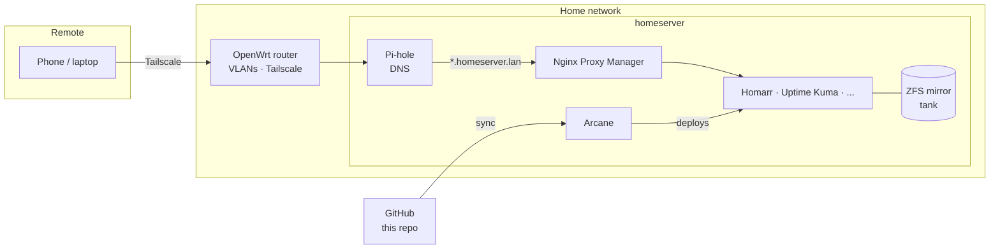

# homelab

Infrastructure-as-code for my home server. Every service runs as a Docker Compose stack defined in this repo, and [Arcane](https://github.com/ofkm/arcane) deploys them straight from Git — the repo is the source of truth for what's running.

## Hardware

| Component | Details |
|---|---|
| Host | `homeserver` — Intel Core i3-14100 (4C/8T, UHD 730 iGPU with QuickSync) |
| OS | Ubuntu Server 26.04 LTS, bare metal, headless |
| Boot | 128 GB NVMe |
| Storage | 2× 6 TB WD in a ZFS mirror (`tank`) |
| Router | TP-Link Archer A7 running OpenWrt |

## Build notes

The first build didn't go smoothly.

**Used parts from eBay.** To keep costs down, I started with used parts off eBay, including an obscure motherboard that was cheap for a reason. The machine froze partway through the Ubuntu install, and after some troubleshooting it was clear the parts were faulty. I ended up swapping out both the CPU and the motherboard, which is how it landed on the i3-14100. The lesson was that a cheap, obscure board isn't a bargain if it won't boot an installer.

**The drives.** I bought the two 6 TB WD drives around the start of 2026, before AI datacenter demand drove hard drive prices up. That turned out to be the best-timed purchase of the build.

## Architecture



- **Remote access** is Tailscale only. Nothing is port-forwarded to the internet. Tailscale split DNS sends `homeserver.lan` lookups to Pi-hole, so the same hostnames work away from home.
- **DNS:** Pi-hole is the LAN's DNS server and ad blocker. It resolves `*.homeserver.lan` to the server; Nginx Proxy Manager routes each name to its container (e.g. `home.homeserver.lan` → Homarr, `kuma.homeserver.lan` → Uptime Kuma).
- **Network:** the server has a static DHCP lease on OpenWrt, which also handles VLAN segmentation.

## Deployment workflow

```
edit compose file ──► commit to GitHub ──► Arcane syncs ──► stack redeployed
```

1. A change to a compose file is committed to `main`.
2. Arcane pulls the repo and redeploys the affected stack.
3. [Renovate](https://docs.renovatebot.com/) watches pinned image tags and opens a PR when a new version ships, so updates are reviewed and versioned like any other change. Major versions wait for manual approval.

Image tags are pinned to exact versions — no `:latest` — so what's in Git is exactly what's running.

### Why Arcane

I started on Dockge, evaluated Komodo, and settled on Arcane:

- **Dockge** is a good compose UI but has no Git sync, so the server and repo drifted apart.
- **Komodo** does GitOps well but is more platform than a single host needs.
- **Arcane** syncs stacks straight from a Git repo with a clean UI and a light footprint — the right size for one server.

## Repository layout

```
stacks/
├── homarr/        compose file + .env.example
├── npm/
├── pihole/
└── uptime-kuma/
renovate.json
```

Each stack folder holds its compose file and a `.env.example` listing the variables it needs. Real `.env` files live only on the server and are never committed.

## Services

### Running

| Service | Purpose |
|---|---|
| [Arcane](https://github.com/ofkm/arcane) | Stack manager, deploys from this repo |
| [Nginx Proxy Manager](https://nginxproxymanager.com/) | Reverse proxy for `*.homeserver.lan` |
| [Pi-hole](https://pi-hole.net/) | Network DNS and ad blocking |
| [Uptime Kuma](https://github.com/louislam/uptime-kuma) | Monitoring and alerts (Discord) |
| [Homarr](https://homarr.dev/) | Dashboard |

### Planned

| Service | Purpose |
|---|---|
| Immich | Photo library |
| Paperless-ngx | Document archive with OCR |
| Jellyfin + Sonarr / Radarr / Prowlarr / Bazarr | Media server and library automation |
| Navidrome | Music streaming |
| Actual Budget, Ghostfolio | Budgeting and investment tracking |
| Prometheus + Grafana | Metrics and dashboards |

## Monitoring

Uptime Kuma watches the stack and the network, and sends alerts to Discord. Homarr shows its status on the dashboard.

| Monitor | What it checks |
|---|---|
| Arcane, npm, Pi Hole | The core services are up |
| Pi Hole DNS, Cloudflare DNS | Local and upstream DNS resolve |
| Internet, Router | The WAN link and OpenWrt router |
| Disk Space | Free space on the server |
| ZFS health | The `tank` pool is healthy |

## Storage

All persistent data lives on the ZFS mirror, one dataset per kind of data, so snapshots and backups can be scoped independently:

| Dataset | Contents |
|---|---|
| `tank/appdata` | Container config and databases, one folder per service |
| `tank/media` | Movies and TV, with downloads alongside so imports are hardlinks, not copies |
| `tank/music` | Music library |
| `tank/photos` | Photo library |
| `tank/files` | Documents |

The mirror protects against a dead drive. [Sanoid](https://github.com/jimsalterjrs/sanoid) takes local snapshots on a schedule. Offsite backups will go to Backblaze B2 and be taken from ZFS snapshots, not live files, so each backup is a consistent point in time.

## Setting up a stack

```bash
cp stacks/<name>/.env.example /opt/stacks/<name>/.env   # fill in real values
```

Then add the stack in Arcane, pointing at its folder in this repo.

## Roadmap

- [x] Migrate all app data from the boot drive to `tank/appdata`
- [x] Pin image tags and let Renovate handle updates
- [x] ZFS snapshots with sanoid
- [x] Uptime Kuma alerts to Discord
- [ ] Offsite backups to Backblaze B2 from ZFS snapshots
- [ ] Immich and Paperless-ngx
- [ ] Media stack
- [ ] Finance tools
- [ ] Prometheus + Grafana
